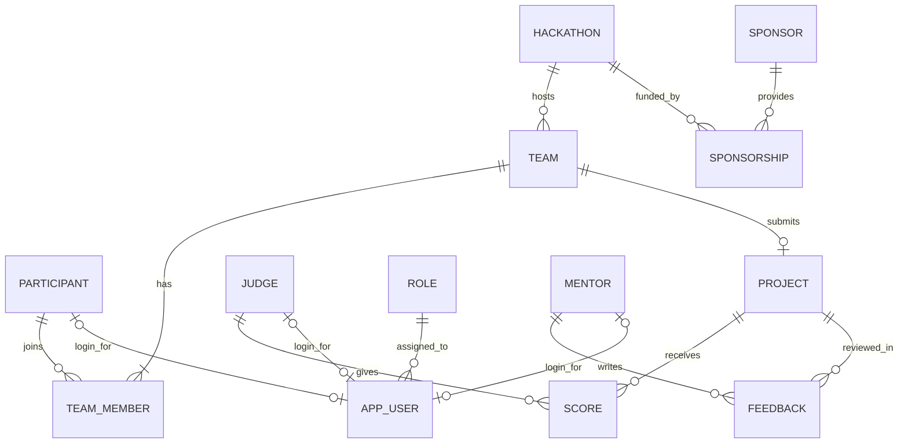

# Hackathon Management System
Next.js + MySQL (relational) + MongoDB (NoSQL / vector-style search), with JWT auth and role-based access control.

## Technology justification
- **MySQL**: hackathon data is highly relational (teams, members, scores) and needs integrity (FKs, CHECKs, triggers, transactions).
- **MongoDB**: project ideas are flexible documents (variable tags, free text, embeddings) that do not fit a fixed schema. Each idea stores a 64-dim embedding, and similar ideas are found by cosine similarity (vector search).
- **Next.js**: one codebase for the React UI and the API route handlers.

## ER diagram

(`AUDIT_LOG` is a standalone table written by a trigger.)

## Relational schema (PK underlined in the report, FK marked *)
HACKATHON(hackathon_id, name, city, start_date, end_date) | PARTICIPANT(participant_id, name, email, college) | TEAM(team_id, team_name, hackathon_id*) | TEAM_MEMBER(team_id*, participant_id*, is_lead) | PROJECT(project_id, title, track, repo_url, team_id* UNIQUE) | JUDGE(judge_id, name, expertise) | SCORE(project_id*, judge_id*, innovation, technical, impact) | SPONSOR(sponsor_id, name) | SPONSORSHIP(hackathon_id*, sponsor_id*, amount, tier) | ROLE(role_id, role_name) | APP_USER(user_id, email, password_hash, role_id*, participant_id*, judge_id*, mentor_id*) | MENTOR(mentor_id, name, expertise) | FEEDBACK(feedback_id, project_id*, mentor_id*, rating, comment, created_at) | AUDIT_LOG(log_id, action, details, created_at)

## Run with Docker (recommended)
Needs Docker Desktop and Node.js 20.6 or newer.
```bash
docker compose up -d     # MySQL on port 3307, MongoDB on 27017; db/*.sql loads automatically on first start
# wait about 60 seconds for MySQL to finish loading the SQL files
docker compose exec -T mongo mongosh < db/mongo_init.js
cp .env.example .env.local
npm install
npm run seed
npm run dev              # http://localhost:3000
```
Stop with `docker compose down`. Reset all data with `docker compose down -v`.

## Run without Docker (local MySQL and MongoDB)
Use MySQL 8 and MongoDB 6 or 7. In `.env.local`, change the MySQL port in `MYSQL_URL` from 3307 to 3306.
```bash
mysql -u root -p < db/01_schema.sql && mysql -u root -p < db/02_advanced.sql && mysql -u root -p < db/03_mentor.sql
mongosh < db/mongo_init.js
cp .env.example .env.local     # edit passwords
npm install && npm run seed && npm run dev   # http://localhost:3000
```
Demo logins (password `password123`): admin@hack.com, priya@hack.com (judge), aarav@mail.com (participant), mentor@hack.com (mentor).

## Rubric mapping
| Rubric item | Where |
|---|---|
| ER diagram | this README, dashboard page |
| Relational schema | this README |
| SQL DDL + constraints | `db/01_schema.sql` (PK, FK, UNIQUE, CHECK, ENUM, ON DELETE CASCADE) |
| NoSQL / vector DB creation | `db/mongo_init.js` (schema validator, indexes), `lib/embed.js` |
| DML | `db/02_advanced.sql` (INSERT/UPDATE/DELETE/CALL) |
| Nested / correlated / recursive / joins | `db/02_advanced.sql` |
| Procedure, function, trigger, CTE | `sp_register_team`, `fn_project_avg`, `trg_team_size`, `trg_score_audit`, CTE queries |
| NoSQL / vector feature + RUD | `app/api/ideas/*` (create, read, similarity search, update, delete) |
| Next.js interface | `app/page.js` |
| Backend/API + DB integration | `app/api/*`, `lib/db.js`, `lib/mongo.js` |
| Auth + 2+ roles + DB RBAC | `app/api/login`, `lib/auth.js` (guard), `role`/`app_user` tables, MySQL `CREATE ROLE`/`GRANT` |
| Documentation + Git | this README + git steps below |

## Git
```bash
git init && git add . && git commit -m "Initial hackathon management system"
git branch -M main && git remote add origin <your-repo-url> && git push -u origin main
```
Make small commits per feature (schema, auth, ideas API, UI) so your history shows individual contribution.

## Viva prep
- Why two databases? Relational integrity vs flexible documents plus similarity search.
- How is RBAC enforced? Three layers: UI hides actions, API `guard(role)` returns 403, and MySQL roles restrict privileges.
- What is the vector feature? Text is turned into a 64-dim normalized vector and ranked by cosine similarity. In production, swap in a real embedding model and Atlas Vector Search.
- Normalization: every table is in 3NF, and junction tables resolve M:N relationships.
